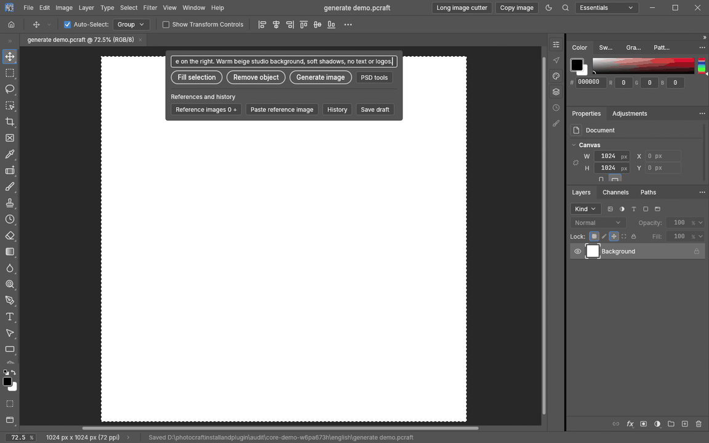
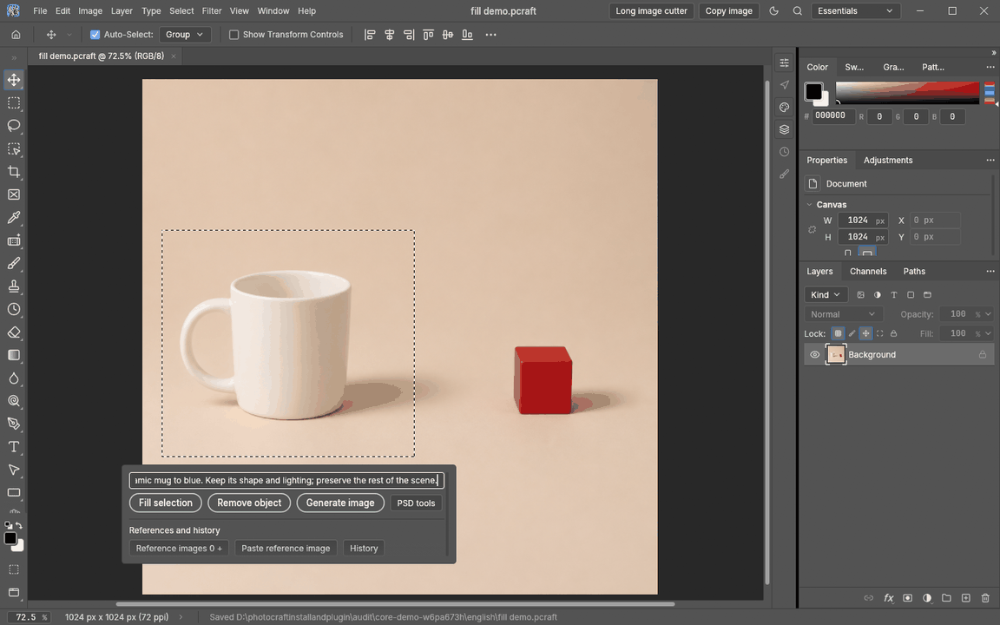
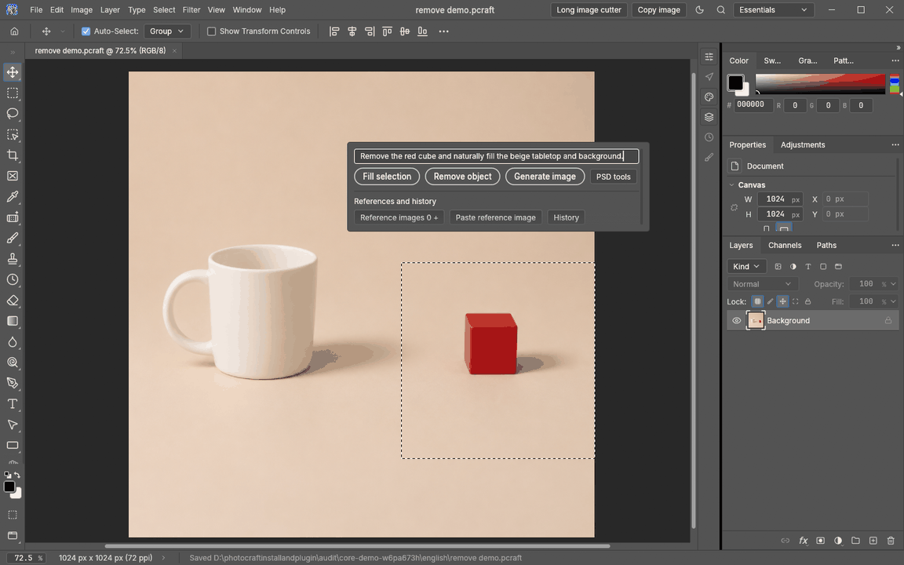
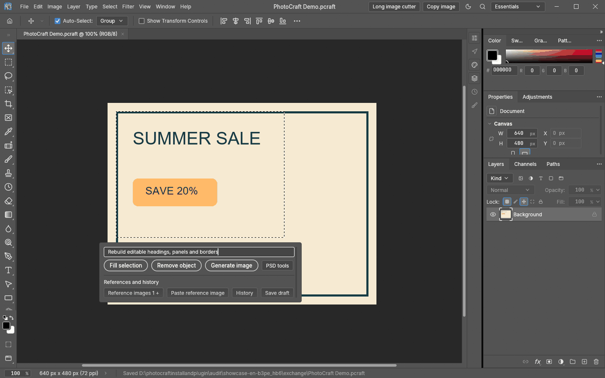
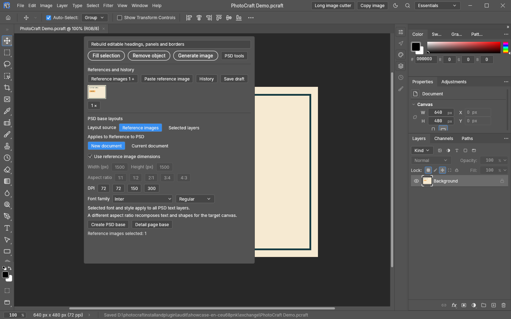
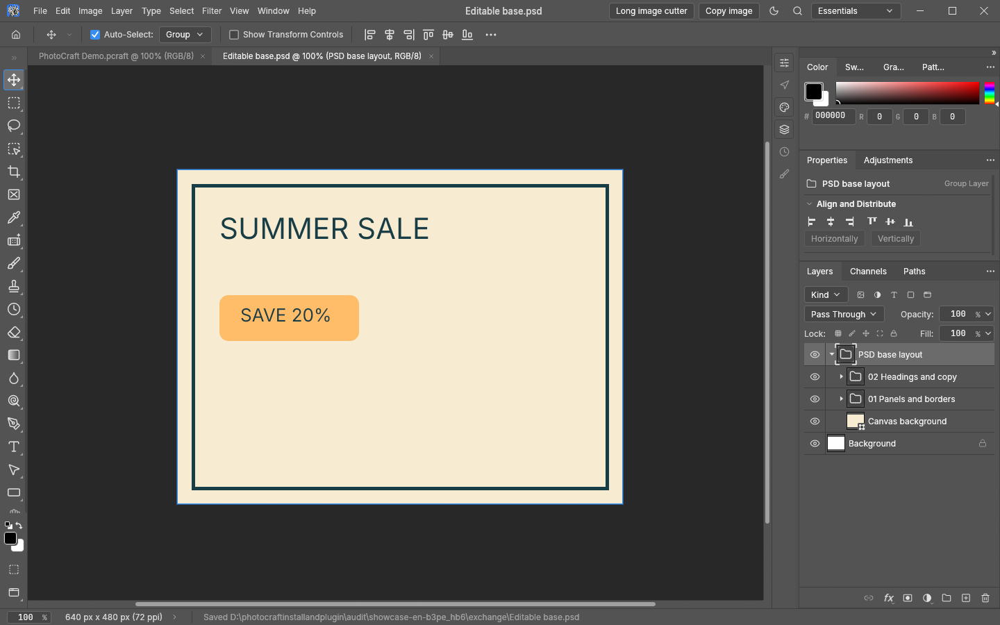
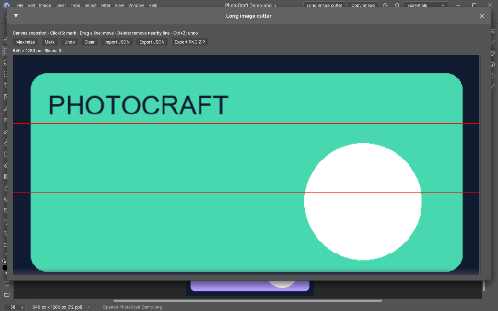

# PhotoCraft · Codex AI

[中文](README.md) · [English guide](docs/usage-en.md) · [Release notes](RELEASE_NOTES.md)

**One drawer for AI editing, references and editable PSD base layouts.**

## Core features in action

### 1. Generate an image

Enter a prompt on a blank canvas. The generated still life is added as a new layer.



[View still result](examples/usage/en/generate-result.png)

### 2. Edit a selected area

Select the white mug and change it to blue while preserving the red cube and the background outside the selection.



[View still result](examples/usage/en/fill-result.png)

### 3. Remove an object

Select the red cube and its shadow, remove them and fill the tabletop naturally while retaining the mug.



[View still result](examples/usage/en/remove-result.png)

These original examples were produced by actual Codex image-generation/editing requests through the plugin. Waiting is condensed; the English recording replays the same generated outputs through the local workflow. Playback duration does not represent model latency.

## More tools: editable PSD bases



Follow the prompt and reference, expand all PSD settings, create the base layout, then reveal its named groups. Recorded in the actual application using a pre-analyzed original sample. No remote model call is made in this demonstration; animation timing does not represent generation speed.

## What you can do

| Feature | Workflow |
| --- | --- |
| AI editing and generation | Fill a selection, remove objects or generate artwork above the selected layer |
| Multiple references | Select files, drag images or paste from the clipboard; restore prompts and references from history |
| Image/layer to PSD | Use attached references or selected layers; work in the current document or a new one |
| Batch references to PSD | Convert each reference into its own PSD, with per-item progress and durable results/report |
| Adapt an existing PSD ratio | Recompose for target dimensions, scale content uniformly and preserve text, smart objects and groups in a new copy |
| Unified PSD settings | Font family/style, pixel dimensions, aspect ratio and DPI beside creation actions |
| Title / subtitle / body styles | Independent family, weight/style and pixel size, with automatic sizing and batch support |
| Named major groups | One root folder and at most eight section groups, collapsed by default; text and shapes stay editable |
| Long detail-page bases | Read the entire page in crops and reconstruct copy, colors, shapes and borders; up to 30000 pixels tall and 32 million pixels total |
| Cutting and clipboard export | Adjust cut lines, save JSON plans, export PNG ZIPs and copy the full canvas |
| Project history | Store prompts and reference snapshots per project without creating duplicate records on restore |

PSD bases exclude products, people and photographic backgrounds. Review OCR and layout manually. [Full guide](docs/usage-en.md)

## Updated interface

### Settings and creation in one drawer



### Named folders instead of scattered layers



### Long-image cutting



These demos show the current unified development build. The published v0.4.0 ZIP predates some of these features; distinguish current source/local updates from the older package.

## Usage

**Current unified development build:** one PhotoCraft 0.20.1 hosts Codex AI with multi-image references, Userfull Tools' long-image cutter and canvas clipboard export, shared language handling, size adaptation, feathering and timing. Launch with `start.cmd`; local legacy Userfull launchers now point to the same editor. No new package is produced for this merge; the published v0.4.0 ZIP predates the complete merge.

v0.4.0 integrates PhotoCraft 0.20.1 and multi-image references into the original Codex AI plugin. Both source and portable builds use 0.20.1; continue launching with `start.cmd`.

Multi-image references are now integrated into the original Codex AI plugin. Choose several images using the reference button, or drop them onto the AI toolbar; thumbnails are individually removable. Refer to them as “reference 1”, “reference 2”, etc. Continue launching with `start.cmd`; the separate Userfull Tools editor is not required.

v0.3.0 upgrades the matching editor to PhotoCraft 0.19.0 while retaining AI tools, direct image receipt, and editable mask feathering.

v0.3.1 fixes sharp feather boundaries with an inward fade to full transparency, and displays total elapsed time after successful generation. Adjust an existing layer's feather slider to apply the new mode.

Use **Edit selection, Remove object, and Generate image** directly inside PhotoCraft, from a native toolbar next to your selection. The integration uses your locally installed Codex CLI, its built-in image generation tool, and your existing sign-in. Results are imported as new layers with undo support.

### Download and start

1. Download **`photocraft-codex-ai-0.4.0-windows-x64-local-node.zip`** from the [v0.4.0 release](https://github.com/kaliwell/photocraft-codex-ai/releases/tag/v0.4.0).
2. Extract the entire archive into a writable folder. It includes the matching PhotoCraft editor, Python 3.13.5, and Pillow 11.3.0. **Node.js and Codex CLI are not bundled.**
3. Use your existing Node.js and npm-installed Codex CLI. If Codex is missing, run `npm.cmd install -g @openai/codex`.
4. Double-click **`start.cmd`**. Your existing Codex sign-in is reused; otherwise, follow the sign-in prompt for your own account.
5. Open an image in the newly launched editor, make a rectangular or lasso selection, enter a description, and choose an operation from the selection toolbar.

An internet connection and a Codex installation/account with working built-in image generation are required. GitHub's automatically generated **Source code** archives do not include the editor binary. The Windows x64 package is a preview development build: plugin 0.4.0 with a modified PhotoCraft 0.20.1 editor.

### Usage

| Operation | Behavior |
| --- | --- |
| Edit selection | Edit the selected area using your description; default feather: 12 px |
| Remove object | Remove the selected object and fill the background; no description required; default feather: 12 px |
| Generate image | Generate content inside the selection; default feather: 0 px |

Results are added as new layers, preserving the original. Press **Ctrl+Z** to undo. The toolbar is hidden when there is no selection; select the whole canvas for a full-image prompt. It follows the selection, zoom, pan, and rotation, moving above the selection near the bottom edge. Progress, cancellation, and errors appear in the toolbar.

**New in v0.2.9: editable mask feathering.** Right-click an AI result layer → **Edge feathering**. Choose the original selection, a centered circle, or a square, then adjust the **0–1000 px** slider or enter a value. The center comes from the layer's original pixel coverage; transparent results use their actual pixel bounds. New results have separate masks that can be adjusted without generating another image, support undo/redo, and persist in `.pcraft` files. Soft edges already baked into pixels by older versions cannot be reversed.

[Context menu example](examples/editable-mask-menu.png) · [Editable mask document](examples/editable-mask-demo.pcraft) · [Layered demo](examples/codex-ai-native-demo.pcraft)

### Proxy and local files

To use an explicit HTTP/mixed proxy, create `runtime/codex-proxy.json` inside the installation folder:

```json
{"url":"http://127.0.0.1:10808"}
```

`10808` is an example: replace it with your own proxy port and keep your proxy running. This setting applies only to Codex child processes launched by the plugin. It does not change system settings or global Codex configuration; local editor traffic bypasses the proxy. Delete the file to resume inheriting the existing network environment.

- Launch with `start.cmd` so both the editor and worker start. Do not launch only `native/photocraft.exe`.
- Editor settings are stored in `runtime/native-profile/`. Task images, prompts, results, and logs are stored in `runtime/native-jobs/`.
- Other PhotoCraft installations remain separate. Save your documents and close the old version before extracting an update. Update the matching editor through the plugin package to avoid replacing it with the upstream editor.

### Data handling and limitations

- Selection edits send **the full flattened source image and a reference image marking the selection** to Codex image generation. The selection limits local result compositing, not what is uploaded.
- The plugin uses the existing CLI sign-in without extracting login credentials and does not automatically fall back to a paid API. Cancellation stops the child process; a server-side job already in progress may still consume quota.
- The worker accepts token-authenticated localhost requests and rejects browser Origin requests. Codex runs with the `workspace-write` sandbox, `image_generation` enabled, and multi-agent mode disabled.
- Automatic import is refused if the document has changed or closed. A mismatched aspect ratio also prevents import while preserving the output; a different resolution with the same aspect ratio is scaled proportionally.
- Exported images and generated layers use 8-bit PNG. Professional fidelity for high-bit-depth documents and special color spaces has not been verified.
- Image generation availability depends on the Codex installation, account, model, and sandbox. Enabling the feature does not guarantee service access; failures are displayed and logs are retained.

### Source, fallback panel, and validation

See [native-source/README.md](native-source/README.md) for the Rust/egui patch and rebuild instructions. The bridge derives from OpenFill (Apache-2.0); component and license details are in [THIRD_PARTY.md](THIRD_PARTY.md).

The fallback Tk panel is mainly for source installations. It requires Python 3.10+ with Tk, Pillow, a desktop PhotoCraft installation, and a signed-in Codex CLI. Its source launcher is `start-panel.cmd`:

```powershell
pip install -r requirements.txt
python -m photocraft_ai --photocraft "D:/PhotoCraft/photocraft.exe"
```

The panel supports text-to-image, selection editing, and object removal, with a preview before applying results. Tasks are stored in `runtime/jobs/`. For the native Windows release, use `start.cmd`.

```powershell
python -m unittest discover -s tests -v
python -m photocraft_ai --connect-only
python tests/smoke_photocraft.py
```

See [VALIDATION.md](VALIDATION.md) for recorded results and known testing boundaries. These source-install commands require their dependencies and the matching editor; integration tests create test documents. Live image generation requires service access and consumes quota.

### Version history

| Version | Main change |
| --- | --- |
| [0.3.0](https://github.com/kaliwell/photocraft-codex-ai/releases/tag/v0.3.0) | Upgrade the matching editor to PhotoCraft 0.19.0, retaining all AI integration features |
| [0.2.9](https://github.com/kaliwell/photocraft-codex-ai/releases/tag/v0.2.9) | Editable layer masks; original selection/circle/square; 0–1000 px feathering |
| [0.2.8](https://github.com/kaliwell/photocraft-codex-ai/releases/tag/v0.2.8) | Receive complete PNGs directly from the current session; fix failed Windows copy commands preventing import |
| [0.2.7](https://github.com/kaliwell/photocraft-codex-ai/releases/tag/v0.2.7) | Use local Node.js and npm-installed Codex instead of bundling them |
| [0.2.6](https://github.com/kaliwell/photocraft-codex-ai/releases/tag/v0.2.6) | Legacy portable bundle including Python, Pillow, PhotoCraft, and Codex CLI |
| [0.2.5](https://github.com/kaliwell/photocraft-codex-ai/releases/tag/v0.2.5) | Remove extra feathering for image generation; preserve the original selection mask |
| 0.2.4–0.2.1 | Per-plugin proxy, HTTPS error classification and timeout, local edit feathering, single-generation and latency improvements |


### Automatic PSD background outpainting

When Adapt PSD ratio changes the aspect ratio of a document with a canvas-spanning raster scene, it automatically uses the existing Codex image generator to extend that scene. No extra steps; image generation must be available. Text, logos and shapes reflow separately. Original scene/repair layers remain hidden in the copy, with an added AI outpainted background layer. Original interior scene pixels are retained with edge blending; AI-generated extensions require visual review. Failed or cancelled generation does not replace the source project.


Ratio adaptation checks leading full-canvas stamped previews against the editable stack underneath. Only near-matching covers are hidden in the output copy so the original layered content can reflow. Hidden historical versions stay hidden; the source file is unchanged. Card groups retain their clipping relationships, and flat backgrounds adapt without image generation.


### Audit fixes and cache management

- Clipped or masked groups stay together during outpainted reflow.
- Stamped previews use full-resolution RGBA comparison (maximum difference 2 per channel), retaining local wording, price or logo changes.
- Single-layer PSDs support whole-image adaptation/outpainting, skipping layout analysis when there is no independent foreground.
- Run `cache-status.cmd` to inspect storage or `clean-cache.cmd` to remove known intermediate files from completed tracked jobs. CLI: `python portable_launcher.py --cache-status` or `--clean-cache`.
- After each job, eligible intermediates expire after 14 days or are pruned oldest first above 2 GiB. These limits apply only to intermediate cache. Generated artwork, PSD/PSB files, history, exchange outputs, unmarked legacy jobs and unfinished jobs are retained. Legacy caches are not retroactively removed.
