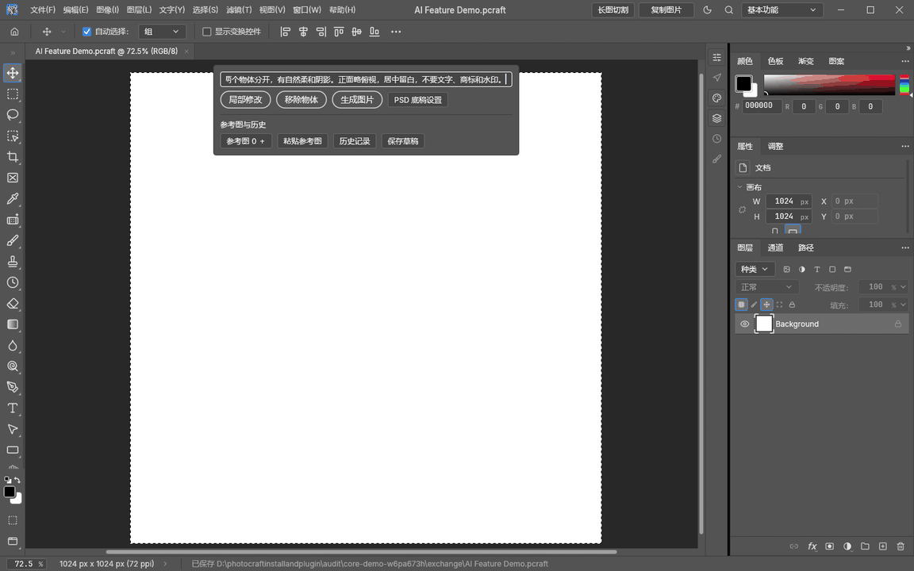
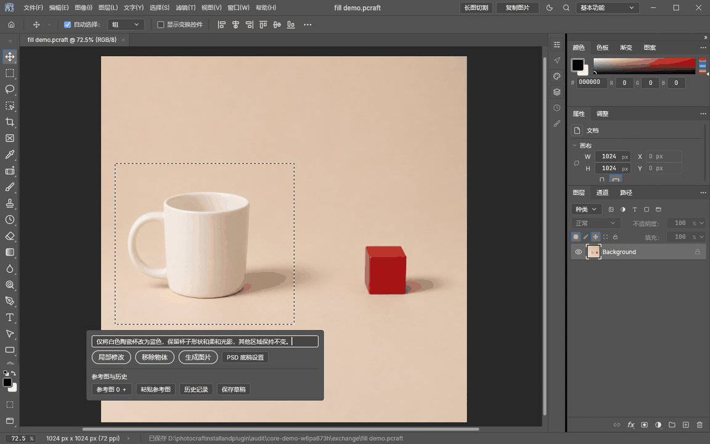
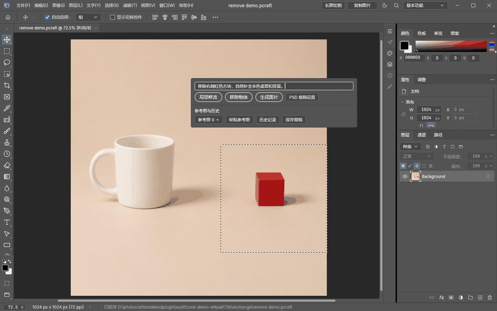
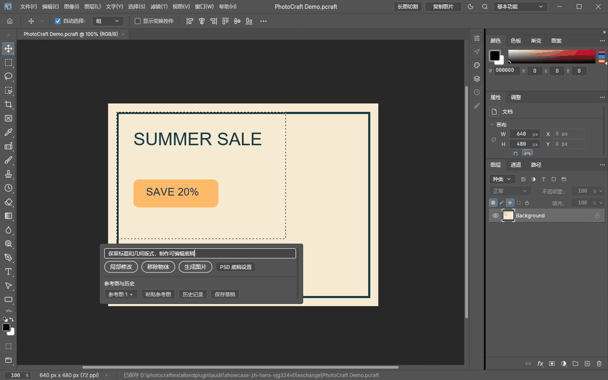
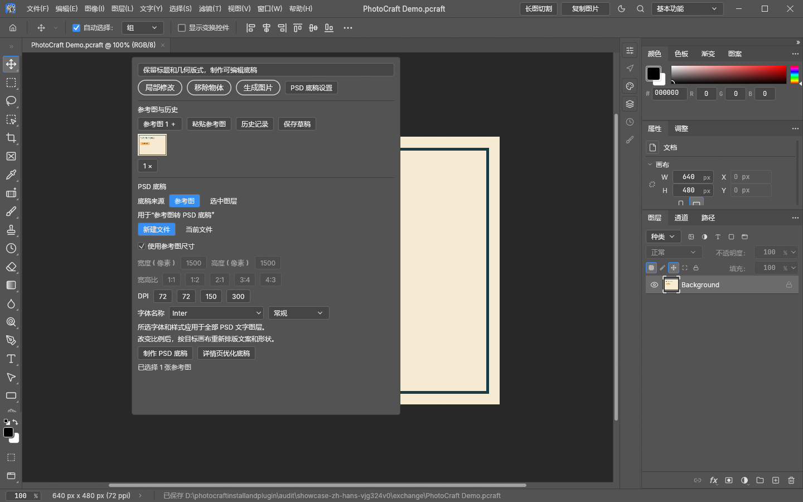
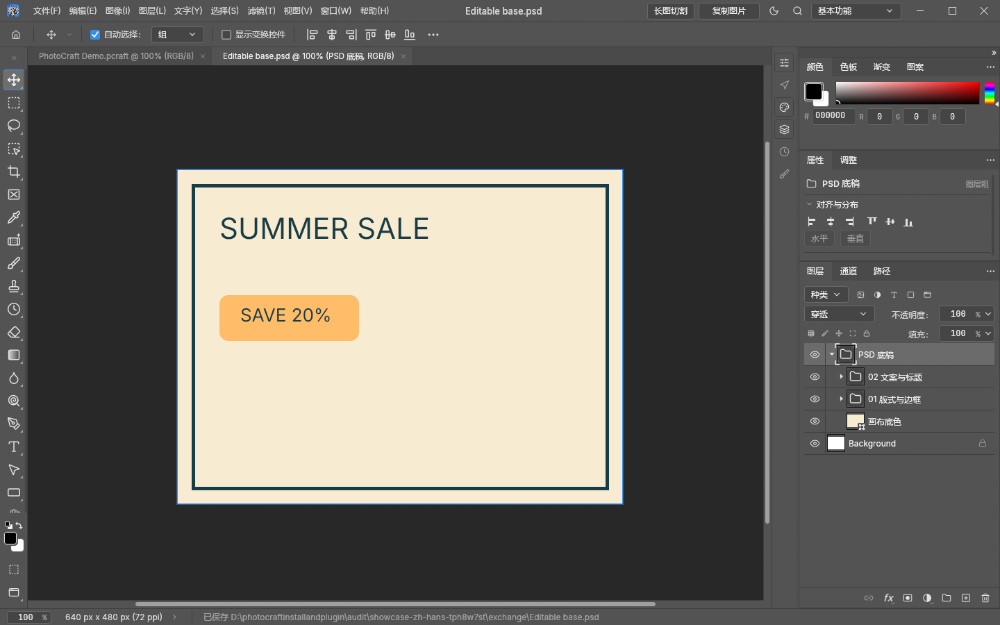
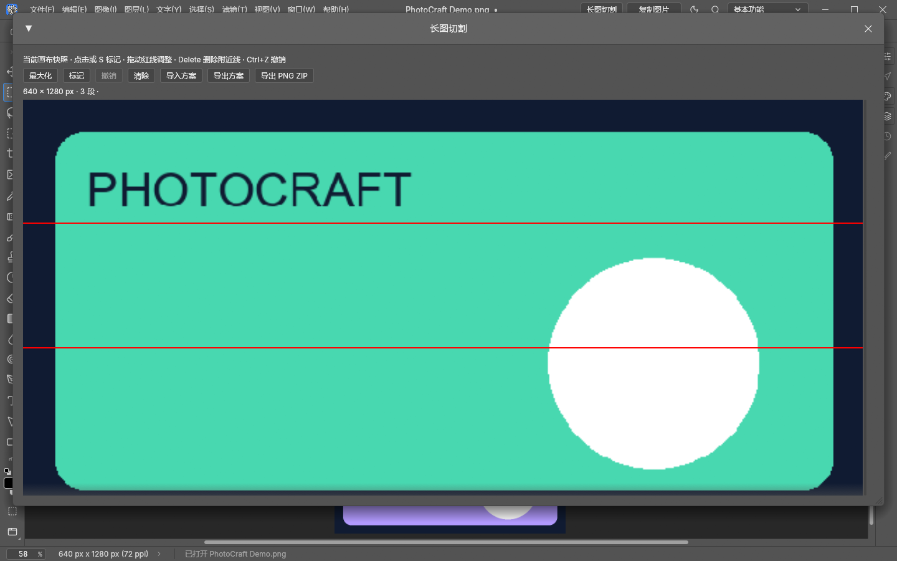

# PhotoCraft · Codex AI

[English](README.en.md) · [中文使用指南](docs/usage-zh.md) · [更新记录](RELEASE_NOTES.md)

**一个抽屉，完成 AI 编辑、参考图和可编辑 PSD 底稿制作。**

## 核心功能动态演示

### 1. 基本生图

输入提示词，从空白画布生成静物场景，结果自动加入新图层。



[查看静态结果](examples/usage/zh-hans/generate-result.png)

### 2. 局部修改

框选白色杯子，将它改为蓝色；右侧方块与选区外背景保持不变。



[查看静态结果](examples/usage/zh-hans/fill-result.png)

### 3. 移除物体

框选右侧红色方块及其阴影，移除后自然补全桌面，保留左侧杯子。



[查看静态结果](examples/usage/zh-hans/remove-result.png)

以上为插件实际调用 Codex 生图/编辑得到的自制场景。动图压缩了等待过程；英文版使用同一组已生成结果重放本地操作，播放时长不代表生成速度。

## 更多功能：PSD 底稿



依次展示：提示词与参考图 → 展开全部 PSD 参数 → 制作底稿 → 展开命名大组。实际软件界面录制，使用预先分析的自制示例运行本地制作流程，未调用远程模型；动画播放时长不代表实际生成速度。

## 现在可以做什么

| 功能 | 使用方式 |
| --- | --- |
| AI 编辑与生图 | 局部修改、移除物体、生成图片，结果插入选定图层上方 |
| 多图参考 | 文件选择、拖入、剪贴板粘贴，配合提示词和历史恢复 |
| 图片或图层转 PSD | 参考图 / 选中图层；当前工程 / 新建文件 |
| 多图批量转 PSD | 每张参考图独立生成 PSD，显示逐张进度，保留结果与处理清单 |
| 现有 PSD 比例自适应 | 按目标宽高重新安排内容区块，图片等比缩放，保留文字、智能对象和分组，另存副本 |
| 单抽屉参数设置 | 字体家族与样式、像素宽高、比例、DPI，与制作按钮放在一起 |
| 标题 / 副标题 / 正文 | 独立字体、粗细样式和像素字号，支持自动字号与批量应用 |
| 命名大组 | 一个底稿总组、最多 8 个区块组，默认折叠，文字和形状仍可编辑 |
| 详情页长图底稿 | 分段读取整页，重建文案、底色、形状和边框；最长 30000 像素、总面积 3200 万像素 |
| 长图切割与剪贴板 | 调整切线、保存 JSON 方案、导出 PNG ZIP、直接复制完整画布 |
| 工程历史 | 提示词与参考图按工程保存，恢复不重复创建记录 |

PSD 底稿不包含产品、人物及摄影背景。文字识别与排版需要人工复核。[完整说明](docs/usage-zh.md)

## 新版界面

### 设置与制作在同一个抽屉



### 命名大组，减少散层



### 长图切割



展示对应当前统一开发版；已发布的 v0.4.0 ZIP 尚未包含全部新功能。请区分最新源码/本地更新与旧版安装包。

## 使用说明

**当前合并开发版**：同一个 PhotoCraft 0.20.1 已包含 Codex AI（含多图参考）、Userfull Tools 的长图切割和复制画布，并统一语言切换、尺寸适配、羽化与耗时显示。使用一个 `start.cmd` 即可；本机旧 Userfull 启动入口也已转到同一软件。本次不生成安装包，下方已发布 v0.4.0 ZIP 尚未包含这次全部合并。

v0.4.0 已同步 PhotoCraft 0.20.1，并将多图参考集成到原 Codex AI 插件中。源码和安装包均使用 0.20.1，继续通过 `start.cmd` 启动。

原 Codex AI 插件现支持多图参考：选区工具栏点击“参考图＋”多选图片，或将图片拖到工具栏；缩略图可单张移除。提示词按“参考图1、参考图2”引用，附件会随生成请求发送。继续使用原来的 `start.cmd`，无需运行 Userfull Tools。详见[参考图说明](docs/reference-images.md)。

v0.3.0 将配套编辑器升级到 PhotoCraft 0.19.0，保留 AI 工具栏、直接图片回传与可调蒙版羽化。

v0.3.1 修复羽化边缘硬截断，向选区内部渐隐到完全透明，并在生成完成后显示本次总耗时。已有图层重新调整羽化滑条即可应用新模式。

在 PhotoCraft 编辑器内部，通过选区下方的原生工具栏进行**局部修改、移除物体和生成图片**。使用本机 Codex CLI 的内置生图能力及已有登录，生成结果自动添加为新图层，支持撤销。

### 下载与启动

1. 在 [v0.4.0 发布页](https://github.com/kaliwell/photocraft-codex-ai/releases/tag/v0.4.0) 下载 **`photocraft-codex-ai-0.4.0-windows-x64-local-node.zip`**。
2. 完整解压到可写目录。压缩包已包含配套 PhotoCraft、Python 3.13.5 和 Pillow 11.3.0；**不包含 Node.js 或 Codex CLI**。
3. 使用电脑现有的 Node.js 和通过 npm 安装的 Codex CLI。尚未安装 Codex 时，执行 `npm.cmd install -g @openai/codex`。
4. 双击 **`start.cmd`**。已有 Codex 登录可直接使用；尚未登录时按提示登录自己的账号。
5. 在新打开的配套编辑器中打开图片，用框选或套索建立选区，在选区工具栏中输入描述并选择操作。

需要网络，以及实际支持内置生图的 Codex 安装与账号。GitHub 自动生成的 **Source code** 压缩包不含配套编辑器二进制。当前 Windows x64 发布包为试用开发构建；原生编辑器基于 PhotoCraft 0.20.1，插件版本为 0.4.0。

### 使用方式

| 操作 | 行为 |
| --- | --- |
| 局部修改 | 根据输入的描述修改选区，默认羽化 12 px |
| 移除物体 | 移除选区中的物体并自然补全，无需输入描述，默认羽化 12 px |
| 生成图片 | 根据描述在选区内生成画面，默认羽化 0 px |

结果以新图层导入，原图保留，可按 **Ctrl+Z** 撤销。无选区时工具栏隐藏；整张文生图可先选中整张画布。工具栏跟随选区、缩放、平移和旋转，靠近底部时移到选区上方。生成期间可取消；错误显示在工具栏内。

**v0.2.9：可编辑蒙版羽化。** 右键 AI 结果图层 → **边缘羽化**，选择原选区、居中圆形或正方形，拖动 **0–1000 px** 滑条或输入数值。形状中心依据图层的原始像素覆盖范围计算，透明结果按实际像素范围计算。新结果使用独立蒙版，无需重新生图即可调整，支持撤销/重做，保存 `.pcraft` 后保留。旧版本已烘焙到像素中的软边无法反向还原。

[右键操作示意](examples/editable-mask-menu.png) · [可编辑蒙版示例](examples/editable-mask-demo.pcraft) · [分层演示](examples/codex-ai-native-demo.pcraft)

### 代理与本地文件

如需显式指定 HTTP/混合代理，在安装目录创建 `runtime/codex-proxy.json`：

```json
{"url":"http://127.0.0.1:10808"}
```

`10808` 为示例端口，请改为自己的代理端口，并保持代理软件运行。配置只传给插件启动的 Codex 子进程，不修改系统或全局 Codex 设置；本地编辑器通信绕过代理。删除该文件可恢复继承原有网络设置。

- 通过 `start.cmd` 启动，以便同时启动编辑器和后台；不要只打开 `native/photocraft.exe`。
- 原生版配置在 `runtime/native-profile/`，任务图片、提示词、结果和日志在 `runtime/native-jobs/`。
- 已安装的其他 PhotoCraft 副本保持独立。更新插件前先保存文档、关闭旧版，再完整解压新版；插件配套编辑器应随插件更新，避免被上游原版覆盖。

### 数据与限制

- 局部编辑会向 Codex 生图服务提交**整张合成原图及带选区标记的参考图**；选区限制本地导入范围，不限制上传范围。
- 插件通过 Codex CLI 使用已有登录，不自行读取登录凭据，不自动切换到付费 API。取消会终止本次子进程，服务端已开始的任务可能仍消耗额度。
- 本地后台只接收经令牌认证的 localhost 请求，并拒绝浏览器 Origin 请求。Codex 使用 `workspace-write` 沙箱，启用 `image_generation`，禁用多代理。
- 生成完成后，若文档已改变或关闭，会拒绝自动导入，避免错位。图片宽高比不匹配时保留结果并拒绝导入；相同比例的不同分辨率会等比例适配。
- 导出和生成图层为 8-bit PNG；高位深和特殊色彩空间的专业保真尚未验证。
- 不同 Codex 安装、账号、模型或沙箱可能不提供内置生图。启用功能不代表服务一定可用；失败时显示错误并保留日志。

### 源码、备用面板与验证

原生 Rust/egui 集成的补丁及重建说明见 [native-source/README.md](native-source/README.md)。桥接代码来自 OpenFill（Apache-2.0），第三方组件与许可证见 [THIRD_PARTY.md](THIRD_PARTY.md)。

备用 Tk 面板主要用于源码环境，需要 Python 3.10+（含 Tk）、Pillow、PhotoCraft 桌面版和已登录的 Codex CLI；源码入口为 `start-panel.cmd`：

```powershell
pip install -r requirements.txt
python -m photocraft_ai --photocraft "D:/PhotoCraft/photocraft.exe"
```

备用面板支持文生图、选区局部修改和移除物体；预览后采用结果。任务保存在 `runtime/jobs/`。Windows 原生发布包优先使用 `start.cmd`。

```powershell
python -m unittest discover -s tests -v
python -m photocraft_ai --connect-only
python tests/smoke_photocraft.py
```

验证记录及已知测试边界见 [VALIDATION.md](VALIDATION.md)。这些源码环境命令需要相应依赖和配套编辑器；实机测试会创建测试文档。真实生图依赖账号和服务，会消耗额度。

### 版本历史

| 版本 | 主要变化 |
| --- | --- |
| [0.3.0](https://github.com/kaliwell/photocraft-codex-ai/releases/tag/v0.3.0) | 配套编辑器升级至 PhotoCraft 0.19.0，保留全部 AI 集成功能 |
| [0.2.9](https://github.com/kaliwell/photocraft-codex-ai/releases/tag/v0.2.9) | 可编辑图层蒙版，原选区/圆形/正方形，0–1000 px 羽化 |
| [0.2.8](https://github.com/kaliwell/photocraft-codex-ai/releases/tag/v0.2.8) | 直接接收本次会话的完整 PNG，修复 Windows 复制命令失败导致无法导回 |
| [0.2.7](https://github.com/kaliwell/photocraft-codex-ai/releases/tag/v0.2.7) | 改用本机 Node.js 和 npm 安装的 Codex，不再打包这两个组件 |
| [0.2.6](https://github.com/kaliwell/photocraft-codex-ai/releases/tag/v0.2.6) | 旧版自带 Python、Pillow、PhotoCraft 和 Codex CLI 的便携包 |
| [0.2.5](https://github.com/kaliwell/photocraft-codex-ai/releases/tag/v0.2.5) | 生成图片取消额外羽化，保留原始选区遮罩 |
| 0.2.4–0.2.1 | 独立代理、HTTPS 错误分类与超时、局部编辑羽化、单次生成和延迟优化 |


### PSD 背景自动扩图

使用「PSD 比例自适应」改变宽高比时，若存在覆盖画布的位图场景，会自动调用现有 Codex 生图能力扩展背景，避免分别移动场景图层造成接缝。无需额外操作；需要生图可用。文字、Logo 与形状单独排版；原背景及修补层在副本中隐藏保留，新增「AI outpainted background」图层。原场景中心像素保留，边缘融合；新区域由 AI 生成，需要检查细节。生成失败或取消时不会替换原工程。
