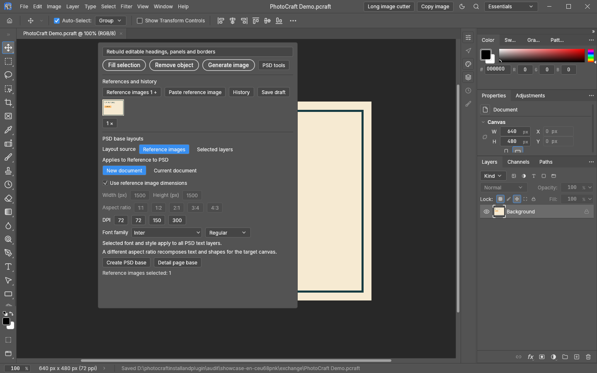

# PSD ratio adaptation and background outpainting

[中文](psd-reflow-zh.md) · [English homepage](../README.en.md) · [Full guide](usage-en.md)

Resize an existing PSD / PSB to specified dimensions and save a new PSD copy. Use it for square-to-portrait layouts, new product-image formats, or extending the background of a flattened image. The source project stays unchanged.

## Use the same settings drawer

1. Open a PSD / PSB, make a selection to reveal the AI toolbar, and expand **PSD tools**. Ratio adaptation processes the whole active project; the selection is not a crop boundary.
2. Set the target width and height, for example **1500 × 2000**. To edit dimensions, choose **New document** and turn off **Use reference image dimensions**.
3. Click **Adapt PSD ratio** and wait for layout analysis or background outpainting. A new document opens, saved beside the source project. The status shows its saved path; review it and continue editing or use Save As.

Existing fonts and DPI are retained. Title/subtitle/body settings apply to new PSD base creation, rather than replacing fonts throughout an existing project.

## How different documents are handled

| Document content | Behavior |
| --- | --- |
| Editable text, shapes and smart objects | Analyze content, reposition and scale uniformly while retaining layers |
| Card grids, clipped or masked groups | Transform the group together, retaining the photo/base relationship |
| Raster scene backgrounds | Use Codex image generation to extend missing areas, keeping the original interior with edge blending |
| Flat-color backgrounds | Adapt directly without image generation |
| Flattened single-layer images | Adapt or outpaint the whole image; baked-in text does not become editable text |
| Leading stamped previews duplicating editable layers below | Compare at full resolution, hide redundant covers in the new copy and reflow the actual layers |

Automatic cover hiding allows at most 2 levels of difference per RGBA channel. A preview with changed wording, prices or a logo is not hidden merely because the overall image looks similar. Hidden historical versions stay hidden.

## Outpainting versus editable base creation

**Ratio adaptation** retains existing products, people and photography. Extending raster scenes uses your account's image-generation capability. Review the AI-generated edges, textures and product details. Original scene layers remain hidden backups; the new scene is named **AI outpainted background**.

**Create PSD base** reconstructs editable text, shapes, flat colors and borders from references or selected layers, excluding products, people and photographic backgrounds. These two actions serve different purposes.

A flattened image cannot recover its original layers automatically. Review complex effects, special filters and color fidelity manually. Each canvas and the intermediate reflow workspace are limited to 32 million pixels. Cancellation or generation failure does not replace the source project.

## Inspect and clean caches

Run `cache-status.cmd` in the installation folder to inspect job and output storage. Run `clean-cache.cmd` to remove known intermediate files from completed, tracked jobs.

Automatic pruning uses **14 days and a 2 GiB intermediate-cache limit**. Generated artwork, PSD/PSB files, project history, exchange outputs, unfinished jobs and unmarked legacy jobs remain intact. This is not a limit on the entire installation directory; old-version jobs are not retroactively deleted.

## Demonstrations and version availability

The interface uses an original geometric project sample. The homepage retains separate generation, selection-editing and object-removal animations. The PSD drawer animation replays a pre-analyzed layout locally without a new remote generation request; playback does not measure model latency. No personal product images or projects are published.

These features describe the current unified development source and local updates. The published **v0.4.0 ZIP predates some features**. [Validation](../VALIDATION.md) · [Release notes](../RELEASE_NOTES.md)

Ratio-adapted PSDs default to the source project folder, e.g. `Poster.psb` → `Poster_自适应_1500x2000.psd`. Existing results receive numbered suffixes instead of being overwritten. The new document adopts this save path for subsequent Ctrl+S. Unsaved projects retain temporary output; failure to write beside the project reports an error and retains the internal export.
