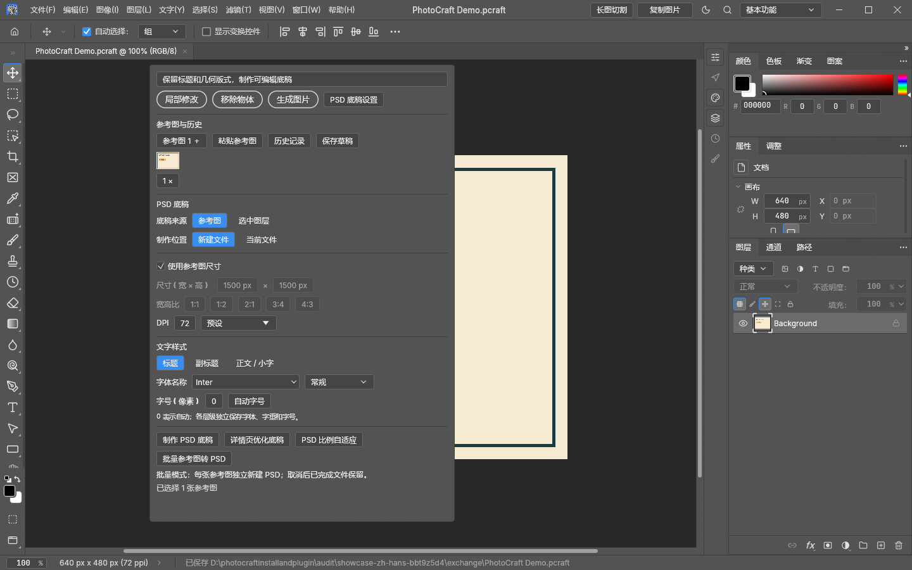

# PSD 比例自适应与背景扩图

[English](psd-reflow-en.md) · [返回中文主页](../README.md) · [完整使用指南](usage-zh.md)

已有 PSD / PSB 可以调整到指定宽高，并另存为新的 PSD。适用于方图改竖图、主图改变版式，以及单层图片需要扩展背景的情况。原工程保持不变。

## 在同一个抽屉中完成

1. 打开需要调整的 PSD / PSB，建立选区以显示 AI 工具栏，再展开「PSD 底稿设置」。比例调整处理整个当前工程，选区不是裁切范围。
2. 设置目标宽度、高度，例如 **1500 × 2000**；需要编辑尺寸时选择「新建文件」，关闭「使用参考图尺寸」。
3. 点击「PSD 比例自适应」，等待布局分析或背景扩图完成。结果打开为新文档，状态栏显示保存路径；确认后另存到项目目录。

现有文档的字体和 DPI 会保留。标题/副标题/正文参数用于制作新的 PSD 底稿，不会强制替换已有工程的字体。

## 不同工程如何处理

| 工程内容 | 调整行为 |
| --- | --- |
| 可编辑文字、形状、智能对象 | 分析内容并调整位置、等比缩放，保留原分层 |
| 四宫格、剪贴或带蒙版的分组 | 整组移动与缩放，保持照片和底板的关系 |
| 位图场景背景 | 调用 Codex 生图扩展空缺区域，中心原图保留、边缘融合 |
| 纯色背景 | 直接适配画布，无需生图 |
| 单层合并图片 | 整图适配或扩图；不会自动将图片里的文字变成可编辑文字 |
| 置顶合并预览与下方原分层重复 | 原始分辨率比对确认后，在新副本中隐藏盖印备份，处理下方实际分层 |

自动隐藏盖印只容许每个 RGBA 通道最多 2 级差异；含有新文案、价格或 Logo 改动的盖印不会仅因整体相似而被隐藏。原来隐藏的历史版本仍保持隐藏。

## 背景扩图与可编辑底稿的区别

**比例自适应**保留现有产品、人物和摄影内容。需要补足位图场景时会使用账号的生图能力；新区域由 AI 生成，完成后需检查边缘、纹理和产品细节。原背景作为隐藏备份保留，新背景位于「AI outpainted background」图层。

**制作 PSD 底稿**根据参考图或选中图层重建文字、形状、底色与边框，排除产品、人物和摄影背景。这两个入口处理的内容不同。

单层图片不会凭空恢复原始分层。复杂效果、特殊滤镜及色彩保真仍需人工检查。尺寸受本地资源保护限制，单个画布及重排工作区最多 3200 万像素。取消或生成失败不会替换原工程。

## 查看和清理缓存

安装目录中的 `cache-status.cmd` 显示任务缓存与成品目录占用；`clean-cache.cmd` 清理已完成、已标记任务的已知中间文件。

自动淘汰规则为 **14 天、2 GiB 中间缓存上限**。生成图片、PSD/PSB、工程历史、交换目录成品、未完成任务和未标记的旧任务均保留。该上限不是整个安装目录的容量上限；旧版任务不会追溯删除。

## 演示与版本

页面中的界面来自项目自制几何示例。主页的基本生图、局部修改、移除物体动态演示继续保留；PSD 抽屉动图使用预先分析的布局录制本地流程，未发起新的远端生图，动画时长不代表生成速度。没有发布用户的产品图片或工程。

这些功能对应当前统一开发版源码和本地更新。已发布的 **v0.4.0 ZIP 尚未包含全部功能**，不能用旧安装包判断上述功能是否可用。[验证记录](../VALIDATION.md) · [更新记录](../RELEASE_NOTES.md)
