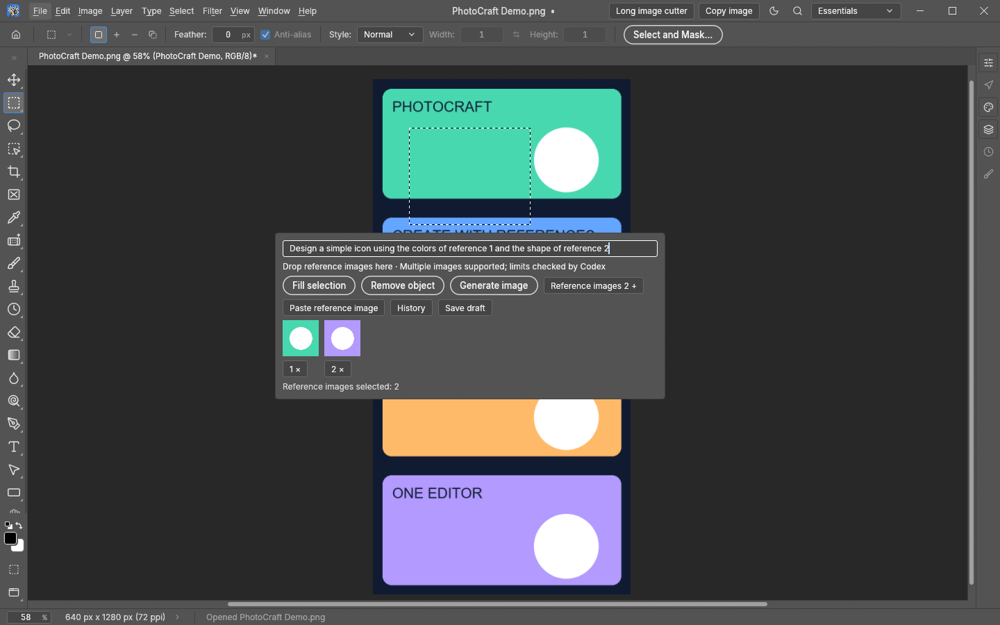
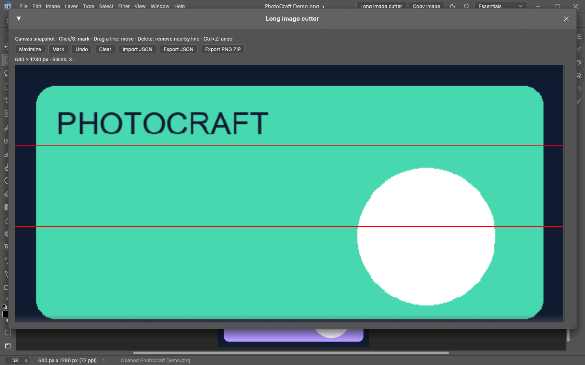
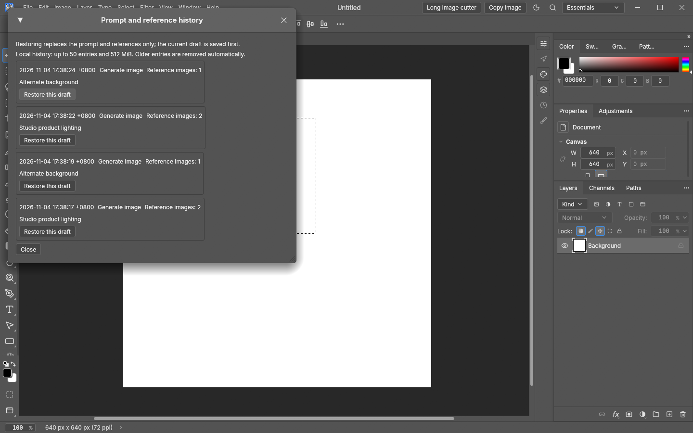

# Unified build: illustrated guide

[中文指南](usage-zh.md) · [Back to README](../README.en.md)

These screenshots show the unified development build on PhotoCraft 0.20.1 (merge commit `d421251`). The published v0.4.0 ZIP predates the cutter, canvas clipboard export and shared language support in this merge. The full feature set below does not describe that older package.

## 1. Selection AI and multiple references

1. Launch with `start.cmd`, open an image and create a selection.
2. Use the reference-images button to select multiple files, or drop pictures onto the AI composer. Click `×` below a thumbnail to remove that reference.
   Use **Paste reference image** or press `Ctrl+V` in the prompt to attach an image from the clipboard.
3. Refer to “reference 1” and “reference 2” in your prompt, then choose **Fill selection**, **Remove object** or **Generate image**. Codex validates actual attachment-count limits; local resource guards also apply.
4. Results become new layers with undo support. Right-click an AI result layer to adjust edge feathering.

This screenshot demonstrates inputs and attachments. No remote generation was run; it is not a generated-result example.

## 2. Long-image cutting

1. Click **Long image cutter** in the title bar to capture the current complete canvas.
2. Click the image or press `S` to add a cut. Drag red lines to adjust them; `Delete` removes the selected line and `Ctrl+Z` undoes a change.
3. **Fit full image** is enabled by default to show the complete long image at its original aspect ratio. Uncheck it to enlarge details. Maximize the window or scroll through the source. Choose **Export PNG ZIP** to save the slices.
4. Import/export JSON plans to reuse cuts or exchange data with LongPicCutter.

## 3. Copy the full canvas

The **Copy image** button at the top of the first screenshot copies the full visible canvas to the system clipboard, preserving transparency. Paste into the destination application. **File → Export → Export to Clipboard** provides the same workflow without an export folder; the selection does not limit the copied area.

## 4. Switch languages

Choose **Edit → Preferences → Interface → Language**, select English or Chinese, then apply. The AI composer and cutter follow the setting; prompts and filenames retain their original text.

The geometric demo artwork was made for this project. Screenshots contain no user photos, account details or job history.

## 5. Prompt and reference history

- From this update onward, successfully prepared generation tasks save their prompt, operation and references automatically. Click **Save draft** to keep inputs before generating.
- Open **History** and choose **Restore this draft**. The selected prompt and ordered reference images replace the composer inputs without creating a record. The composer remains visible and editable. Use Save draft first if you want to keep your current inputs.
- Restoring does not change the canvas, selection or layers, and does not trigger generation.
- Records persist under `<full-project-filename>.photocraft-data/history/` across restarts. Per project, up to 50 entries and 512 MiB are retained, with oldest entries removed when over budget. Older job directories are not imported automatically.
- Prompts and reference snapshots remain local. References are sent only when you submit a new generation request.

[Project data path rules](project-data-en.md)

## 6. Reference to PSD base layout

Open **PSD settings** before generating. By default the reference dimensions are used. Turn off **Use reference image dimensions** to enter target pixel width and height, or use the 1:1, 1:2, 2:1, 3:4 and 4:3 shortcuts. For example, recompose a square reference into a **1500 × 3000** portrait base. Ratio shortcuts calculate height from the current width; both dimensions remain editable afterward.

Set **DPI** from 36 to 1200, with 72/150/300 shortcuts. Pixel dimensions determine image size; DPI controls print density. **Font family** uses the Type tool's searchable dropdown, including previews, recent fonts and favorites. Choose an available style beside it, such as Regular, Bold or Italic. Initial settings follow the current Type tool font and style. All generated text uses your chosen font and style; text size still follows the generated layout. Missing fonts may be substituted.

A changed aspect ratio requests recomposition of text, shapes and borders. Review the resulting OCR and layout. Limits are 8192 pixels per side and 32 million pixels total. Settings persist locally and are included in history and drafts; restoring a record restores its settings too.

Attach a reference and choose **Reference to PSD**. Optionally describe the wording or layout to retain. The reference is analyzed into separate editable text, flat colors, rectangles, rounded rectangles, ellipses, borders and simple Bezier paths. Products, people and background photographs are excluded; the original reference is not embedded as an image layer.

The result opens as a new document and is exported to `runtime/exchange/layout-<job-id>.psd`. Use **File → Save As** to choose the final project location. The source document is preserved.

This is layout reconstruction, not pixel-perfect recovery. Check OCR, substituted fonts, positions and complex decorations manually. Up to 150 text/geometric elements are supported; complex illustrations, gradients and photographs are not automatically decomposed into editable objects.

[Test reference](../examples/layout-base-reference.png) · [Editable PSD sample](../examples/layout-base-demo.psd)

Ordinary generated results are inserted above the layer selected when the task starts. With no selected layer they go to the top, preserving the existing undoable import workflow.
