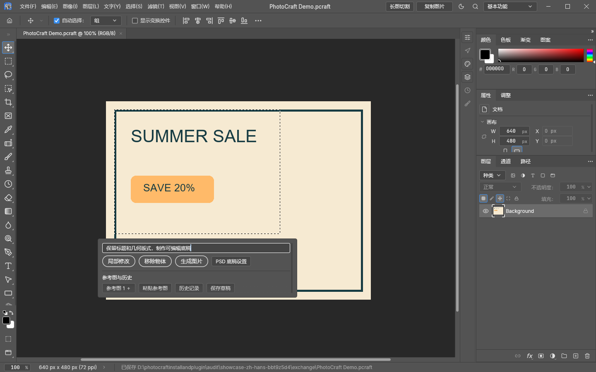
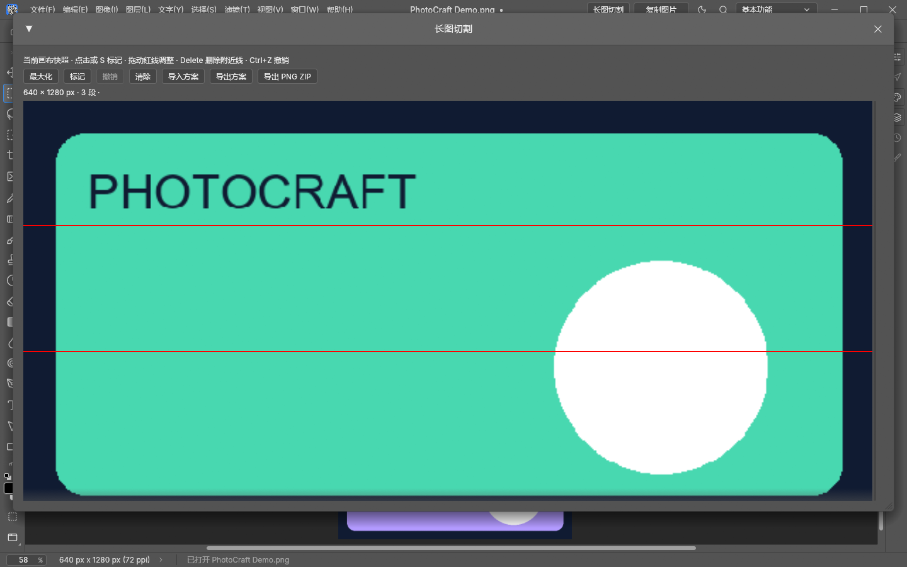
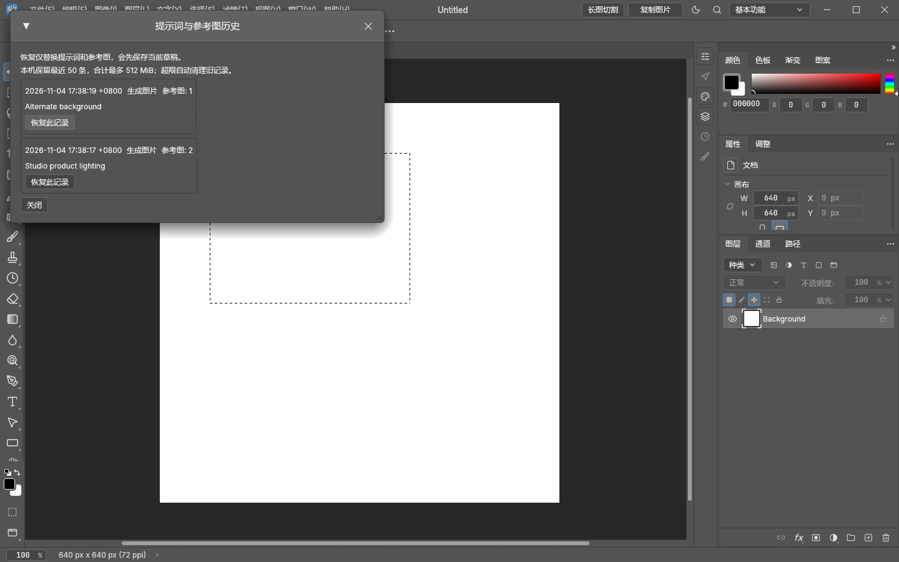

# 统一版功能使用图

[English guide](usage-en.md) · [返回主页](../README.md)

这些截图来自 PhotoCraft 0.20.1 的统一开发版（合并提交 `d421251`）。已发布的 v0.4.0 ZIP 尚未包含长图切割、复制画布及本次统一语言支持；请勿把下面的完整功能图当作该旧包的功能清单。

## 1. 选区 AI 与多图参考

主浮动栏保留提示词、局部修改、移除物体、生成图片，以及参考图添加/粘贴、缩略图、历史和草稿。点击“工具侧栏”展开紧挨主栏的 PSD 工具区，使用底稿来源、PSD 制作与设置；可关闭侧栏。侧栏随主栏位置变化，优先贴在右侧，空间不足时切换到左侧或上下方，不固定在画布边缘。参考图可拖入主栏或已展开的侧栏，也可在提示词内或侧栏上使用剪贴板粘贴。长图缩略图显示顶部区域，实际发送的仍是完整参考图。保存成功后悬停状态文字可查看完整路径。

1. 通过 `start.cmd` 启动，打开图片并创建选区。
2. 点击“参考图＋”多选图片，或将图片拖到 AI 工具栏。缩略图下面的 `×` 可移除对应图片。
   还可点击“粘贴参考图”，或在提示词中按 `Ctrl+V` 添加剪贴板图片。
3. 在提示词中使用“参考图1、参考图2”指定参考内容，再选择“局部修改”“移除物体”或“生成图片”。实际附件张数限制由 Codex 校验，本地资源保护仍适用。
4. 结果导入新图层，可撤销；右键 AI 结果图层可调整边缘羽化。

截图仅展示输入和附件界面，没有执行远端生图，也不是生成效果示例。

## 2. 长图切割

1. 点击编辑器顶部“长图切割”，读取当前完整画布快照。
2. 单击图片或按 `S` 添加切割线，拖动红线调整；`Delete` 删除所选线，`Ctrl+Z` 撤销。
3. 默认勾选“完整显示图片”，等比显示整张长图；取消勾选可放大查看细节。可最大化窗口、滚动查看长图；使用“导出 PNG ZIP”保存切片。
4. “导入方案 / 导出方案”用于保存与交换 JSON 切割方案，支持 LongPicCutter 数据互通。

## 3. 直接复制完整画布

第一张截图顶部的“复制图片”可将完整可见画布复制到系统剪贴板，保留透明度，然后在目标软件中粘贴。也可使用“文件 → 导出 → 导出到剪贴板”，无需先导出文件夹；当前选区不限制复制范围。

## 4. 切换界面语言

编辑 → 首选项 → 界面 → 语言，选择中文或 English 并应用。AI 工具栏和切图界面随设置切换；提示词和文件名保留原文。

示例图片为本项目制作的几何图案。截图中没有用户照片、账号信息或任务记录。

## 5. 提示词与参考图历史回滚

- 本次更新起，生成任务准备成功后会自动保存当次提示词、操作类型和参考图；尚未生成的内容可点击“保存草稿”。
- 点击 AI 工具栏“历史记录”，选择记录并点击“恢复此记录”。恢复选中记录的完整提示词和参考图顺序，不新增记录。修改工具栏保持可见可编辑；需要保留当前内容时请先点保存草稿。
- 恢复仅影响输入区，不替换画布、选区或图层，也不会自动调用生图。
- 记录保存在安装目录 `<工程完整文件名>.photocraft-data/history/`，重启后仍可恢复。保留最近 50 条，记录合计最多 512 MiB，超限自动删除最旧记录；不自动导入更新前的旧任务目录。
- 记录中的图片和提示词只保存在本机；只有再次点击生成时，参考图才随新请求发送。

[工程数据路径规则](project-data.md)

## 6. 参考图转 PSD 底稿

**工具抽屉导航**：点击主栏“工具侧栏”，左侧选择“全部工具”“PSD 底稿”“详情页优化底稿”或“PSD 设置”，右侧显示对应制作操作或参数。设置可直接在抽屉中调整；抽屉仍紧贴主栏展开，参考图和历史继续放在主栏。

**底稿来源**：在 PSD 区域选择“参考图”或“选中图层”，再点“制作 PSD 底稿”或“详情页优化底稿”。图层来源支持多选，将所选图层在完整画布上的合成效果作为参考，不读取其他图层；不受局部选区裁切。无需额外上传参考图。原图层保持不变，制作到当前/新建文件仍由 PSD 设置控制。任务历史保存当时的图层快照，恢复后以参考图方式重用，避免后续图层变化影响历史内容。

**详情页优化底稿（长图）**：添加完整长图作为第一张参考图，点击“详情页优化底稿”。系统分段读取整页，优化文案层级、区块留白和一致性，再按完整画布绝对坐标重建文字、底色、形状和边框；不放入产品及背景照片。事实性文案应保留，识别和排版结果仍需人工检查。新建模式沿用第一张参考图的完整尺寸，不使用普通底稿的自定义宽高；当前文件模式按当前画布重新排版。字体、样式、DPI、制作位置沿用 PSD 设置。最长 30000 像素、宽度最多 8192 像素，总面积最多 3200 万像素，最多 600 个元素。分析可能需要数分钟，可取消。分段参考图不会成为输出图片层。

**制作位置**：在 PSD 设置顶部选择“新建文件”（默认）或“当前文件”。新建文件使用下述尺寸设置，打开独立文档并导出 PSD。当前文件沿用当前画布尺寸和 DPI，在顶部加入底色、文字和形状，原图层保留；不会自动保存或更改工程路径，请完成后保存工程，或另存为 PSD。若生成期间原工程改变或关闭，保留分析结果并停止导入。位置选项随历史和草稿保存。

生成前打开 **PSD 设置**：默认使用参考图尺寸。取消“使用参考图尺寸”后，可填写目标宽、高（像素），或选择 1:1、1:2、2:1、3:4、4:3 比例快捷键。例如将 1:1 参考图重排为 **1500 × 3000** 的 1:2 底稿。快捷键按当前宽度计算高度；之后可分别修改宽高。

**DPI** 支持 36–1200，并提供 72、150、300 快捷值；像素宽高决定图片大小，DPI 决定打印密度。**字体名称** 使用与文字工具相同的可搜索下拉选择器，支持字体预览、最近使用和收藏；旁边可选择该字体提供的样式（如常规、粗体、斜体）。首次设置沿用文字工具当前字体和样式。所有文字使用所选字体和样式，字号仍随版式安排。缺失字体可能被系统替代。

更换比例会请求重新排版文字、形状和边框，仍需人工检查识别和排版结果。每边最多 8192 像素，总面积最多 3200 万像素。设置在本机保留；历史记录和草稿也保存这些参数，恢复时一并恢复。

添加参考图后点击“参考图转 PSD 底稿”，可补充希望保留的文案或版式要求。系统分析参考图，重建独立文字层、底色、矩形/圆角矩形、椭圆、边框和简单贝塞尔曲线；不把产品、人物或背景照片放入 PSD。

结果在新文档中打开，并自动导出到安装目录 `runtime/exchange/layout-<任务ID>.psd`。通过“文件 → 另存为”保存到目标工程目录。原文档保持不变。参考图只用于分析，不作为图片层复制进去。

这是版式重建，不是逐像素还原；文字识别、字体替代、位置和复杂装饰仍需人工检查。当前支持最多 150 个文字/几何元素。复杂插画、渐变和照片不会自动拆解为可编辑对象。

[测试参考图](../examples/layout-base-reference.png) · [可编辑 PSD 示例](../examples/layout-base-demo.psd)

普通 AI 生成结果放在发起任务时选中的图层上方；未选中图层时才放到最顶层，保留原来的可撤销导入方式。
